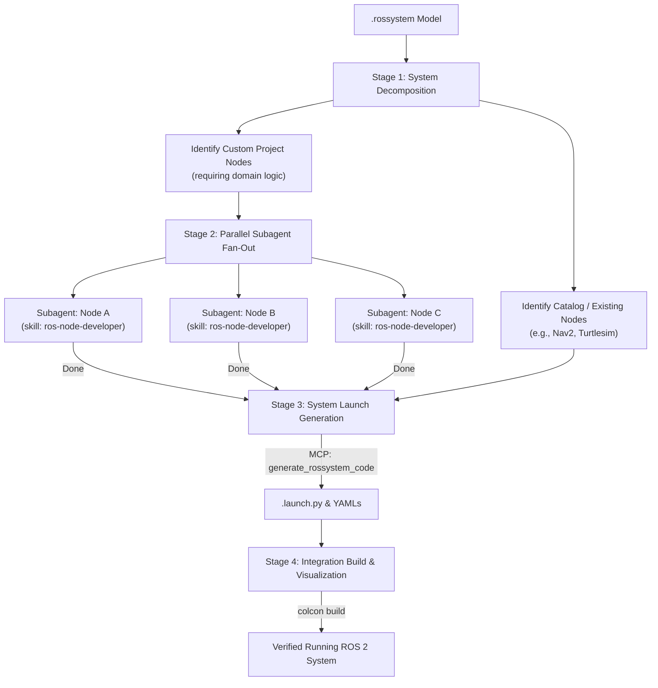

# ROS 2 System Builder (`ros-system-builder`)

Orchestrate the end-to-end development of a complete ROS 2 multi-node system defined by a `.rossystem` model and its accompanying `.ros2` package models.

Building a multi-node robotic system (sensors, filters, controllers, planners, state machines) sequentially in a single chat conversation leads to severe context exhaustion and token bloat. This skill acts as the **lead system architect**, decomposing the system and orchestrating **parallel subagents** (one per custom node) using the [`ros-node-developer`](../ros-node-developer/SKILL.md) skill. If any `.ros`, `.ros2`, or `.rossystem` model is missing or incomplete, author or update it via the `rostooling-mcp` semantic tools (`ros_add_spec`, `ros2_*`, `ros_*`) — never synthesize model DSL text by hand.

---

## Architecture & Lifecycle



---

## 4-Stage Orchestration Workflow

### Stage 1: System Decomposition & Node Discovery

1. **Parse the Target `.rossystem` File**:
   Inspect the `.rossystem` composition to discover all participating node instances:
   - Read each `from: <package_name>.<node_name>` reference.
   - Read all topic, service, and action connections under `connections:`.
   - Read parameter configurations under `parameters:`.
2. **Classify Nodes into Two Tiers**:
   - **Tier 1 (Off-the-shelf / Catalog Nodes)**:
     Pre-existing nodes from ROS distributions or third-party packages (e.g. `turtlesim`, `nav2_amcl`, `robot_state_publisher`).
     *Action*: No logic implementation required.
   - **Tier 2 (Custom Project Nodes)**:
     Application-specific nodes that belong to this project (e.g. `custom_filter_node`, `mission_manager`).
     *Action*: Locate their companion `.ros2` model file in `rosnodes/` or the workspace.
3. **Check Current Status**:
   Inspect whether `src-gen/<pkg>/` already contains an implemented logic file (`*_logic.py` or `*Algorithm.hpp`).

---

### Stage 2: Parallel Subagent Delegation

For every custom node that needs implementation, launch an autonomous subagent using `invoke_subagent`.

> [!IMPORTANT]
> Do NOT implement the nodes yourself in the main thread. Delegate each custom node to a dedicated subagent so compiler outputs and intermediate iterations stay in isolated contexts.

#### Subagent Invocation Template
```python
invoke_subagent(
    TypeName="self",
    Role=f"Node Dev - {node_name}",
    Prompt=f"""You are developing the ROS 2 node '{node_name}' in package '{pkg_name}'.

1. Activate and follow the 'ros-node-developer' skill.
2. The model definition is located at '{ros2_model_path}'.
3. Target language is '{language}' (cpp or python).
4. Run 'generate_ros2_wrappers' to create the communication wrappers.
5. Implement the core domain logic in the generated logic file (*_logic.py or *Algorithm.hpp).
   Behavior specification:
   {node_behavior_description}
6. Run unit tests or compile via 'build_ros2_package'.
7. When the node builds cleanly and passes logic tests, message me back confirming completion.
"""
)
```

#### Wait for Wakeup Notifications
After launching the subagents, end your turn or proceed with other independent planning. You do **not** need to poll in a loop; the messaging system will automatically resume your execution when each subagent reports completion.

---

### Stage 3: System Launch & Wiring Generation

Once all subagents have reported successful implementation of their nodes:

1. **Invoke the System Generator**:
   Call the RosTooling MCP tool `generate_rossystem_code` (or run via CLI):
   ```json
   {
     "model_path": "path/to/my_robot.rossystem",
     "workspace_dir": "path/to/workspace"
   }
   ```
2. **Review Generated Artifacts**:
   The generator produces into `src-gen/<system_name>/`:
   - `<system_name>.launch.py`: The top-level launch file wiring all node executables, processes, lifecycle states, and topic remappings.
   - `params.yaml`: System parameter configuration files.
   - Composable node containers (if configured in the model).
   - PlantUML visual architecture diagrams.

---

### Stage 4: Integration Build & Visualization

1. **Full Workspace Build**:
   Compile the entire workspace to ensure all interconnected packages compile and link against shared interfaces:
   ```bash
   colcon build --symlink-install
   ```
2. **System Graph Visualization (Optional)**:
   Export an auto-laid-out GLSP/ELK SVG directly from the Ecore model via MCP `export_system_diagram`, or generate an interactive standalone HTML architecture diagram using the [`ros-plot`](../ros-plot/SKILL.md) skill:
   ```bash
   python3 scripts/ros_plot.py path/to/my_robot.rossystem --out system_view.html
   ```
3. **Report to User**:
   Provide the user with:
   - Summary of implemented custom nodes and their roles.
   - The path to the generated launch file: `install/<system_name>/share/<system_name>/launch/<system_name>.launch.py`.
   - The exact command to launch the full system:
     ```bash
     source install/setup.bash
     ros2 launch <system_name> <system_name>.launch.py
     ```

---

## Pre-flight Checklist for Orchestrators

- [ ] All missing or updated `.ros`, `.ros2`, and `.rossystem` elements were created/edited through the `rostooling-mcp` semantic tools (`ros_add_spec`, `ros2_*`, `ros_*`), not hand-written as text.
- [ ] All participating models validate cleanly with the Xtext server via MCP `validate_ros_model` (`"isValid": true`, `errorCount === 0`).
- [ ] The `.rossystem` model uses consistent names matching the declared nodes and artifacts.
- [ ] Subagents are instructed to use `ros-node-developer` and never edit wrapper files.
- [ ] `generate_rossystem_code` is invoked *after* all node subagents complete.
- [ ] Full integration build (`colcon build` / `build_ros2_package`) runs with zero compiler errors.
